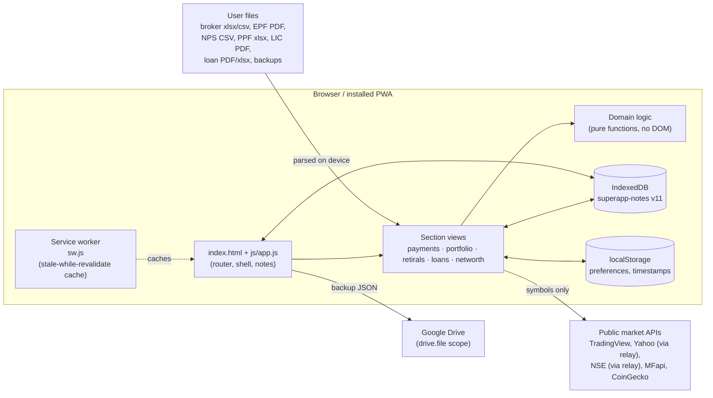
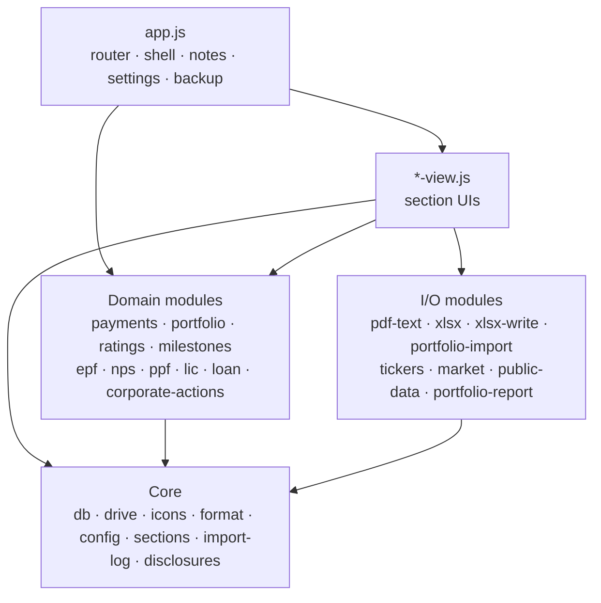
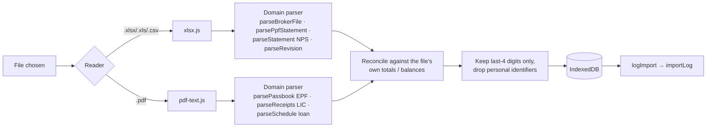

# SuperApp: design and architecture

This document describes how SuperApp is built: the principles behind it, how the code is laid out, where data lives, how data comes in and goes out, and the conventions to follow when changing it. The [README](../README.md) describes what the app does for the person using it. This document covers how it works.

Version described: **1.48.1**.

---

## 1. What the app is

SuperApp is a personal **offline-first Progressive Web App**. It brings together:

- **Markdown notes**, organised into life sections: Personal, Family, Household, Vehicles, Finance and Work.
- **Recurring payments** (Payments).
- **Investment tracking** across brokers (Portfolio).
- **Retirement savings**: EPF, NPS, PPF and LIC (Retirals).
- **Loan schedules** (Loans).
- **A combined Net worth view.**

It is designed for one person on their own devices, with a phone as the main target.

### Design principles

| Principle | What it means in the code |
|---|---|
| **The device holds the data** | All personal data lives in the browser's IndexedDB. No server of ours stores it, and there is no account. Backups go to a file or to the user's own Google Drive. |
| **Works offline** | A service worker caches the whole app shell. Market data is cached locally, and every page renders from what is on the device. |
| **No build step and no dependencies** | Plain HTML, CSS and native ES modules, served as they are. The app has its own readers for PDF text, `.xlsx` and `.xls` files, and its own writers for `.xlsx` and zip. |
| **Private by construction** | Statements are parsed on the device. Only the last 4 digits of account, PRAN, policy and loan numbers are kept. Names, PAN, UAN, date of birth, address, email, nominee and bank details are dropped while parsing. Only ticker symbols and fund or coin names are sent out, never quantities or amounts. |
| **Checked numbers** | Every imported statement is reconciled against its own printed totals or running balances, and any mismatch is shown, not hidden. |
| **Sources are disclosed** | Every outside data source and every derived figure is listed in one registry (`disclosures.js`). The Disclosure page and the info icons both read from it. |

---

## 2. Runtime overview



- **Hosting:** GitHub Pages. The workflow `.github/workflows/jekyll-gh-pages.yml` publishes the repository root on every push to `main`.
- **Local serving:** `serve.ps1`, a minimal static server on `localhost:8080` with `no-cache` headers. The `.claude/launch.json` file defines the preview server.

---

## 3. Code layout

```
index.html               Shell: drawer, #view, toast, <dialog id="modal">; applies forced theme pre-paint
manifest.webmanifest     PWA metadata and icons
sw.js                    Offline cache (ASSETS list + VERSION)
css/styles.css           All styles: tokens, light/dark, per-section accents, components
js/
  app.js                 Entry: state, IndexedDB load, router, drawer, notes UI, settings, backup/restore
  config.js              VERSION, Google client ID, currency/locale
  sections.js            The fixed sections (id, name, icon, colours, presets, app flag)
  db.js                  Thin IndexedDB wrapper (all/put/putMany/del/clear)
  drive.js               Google Identity Services sign-in + Drive upload/download
  icons.js               Inline SVG icon set
  markdown.js            Escape-first Markdown renderer for notes
  format.js              Short-amount formatting (₹2.4L) shared by sections

  ── Section views (render HTML, handle actions) ──
  payments-view.js       Payments dashboard, list, report
  portfolio-view.js      Portfolio: dashboard, brokers, holdings grids, reports, analysis, imports timeline…
  retirals-view.js       Retirals dashboard + EPF / NPS / PPF / LIC pages
  loans-view.js          Loans list, loan page, charts, revisions
  networth-view.js       Balance sheet tree, mix, milestones

  ── Domain logic (no DOM) ──
  payments.js            Recurrence → dues, status, summaries
  portfolio.js           Trade replay into FIFO lots, splits, XIRR, positions, reconcile
  corporate-actions.js   Mergers/demergers/bonuses Yahoo lacks
  ratings.js             Holdings groupings (asset, index, sector, cap…) and stock ratings
  milestones.js          Time-to-target projections (shared by Portfolio and Net worth)
  epf.js / nps.js / ppf.js / lic.js / loan.js   Statement parsers + summaries + clean*()

  ── I/O helpers ──
  pdf-text.js            Library-free PDF text extraction (inflate + ToUnicode)
  xlsx.js                Reads .xlsx (zip of XML), legacy .xls (BIFF) and CSV
  xlsx-write.js          Writes styled .xlsx workbooks (stored zip)
  portfolio-import.js    Broker files → trades/holdings (columns found by heading)
  tickers.js             Company name → ticker matching
  market.js              All public market-data fetches
  public-data.js         Market data as per-month files; zip/unzip for public-data backups
  portfolio-report.js    Print-ready A4 HTML for Save as PDF
  import-log.js          Data-import timeline entries
  disclosures.js         Registry of sources, backup contents and data points
```

### Layering



Rules that hold today and should be kept:

1. **Domain modules never touch the DOM, IndexedDB or the network.** They take plain objects and return plain objects, so they can be tested by importing them in Node.
2. **View modules own their section.** Each one exports the same set of functions, described in section 5.
3. **Only `market.js` talks to market APIs**, and only `drive.js` talks to Google.
4. **`app.js` is the only module that knows about every store.** It handles loading, backup snapshots, merge and replace.

---

## 4. State and storage

### 4.1 In-memory state

`app.js` holds one state object, `S`. At start-up every IndexedDB store is read into `S[store]` as an array. After that, views read from `S` directly and write through `persist(store, obj)`, which updates IndexedDB and marks the data as changed for auto-backup. View preferences, such as the current route, search query and open drawer groups, also live on `S`.

### 4.2 IndexedDB: `superapp-notes`, version 11

| Store | Key | Holds | In backup |
|---|---|---|---|
| `notebooks` | id | Sub-sections of the note sections | ✔ |
| `notes` | id (index `notebookId`) | Markdown notes, archive flag, `deletedAt` for trash | ✔ |
| `payments` | id | Recurring payment plans | ✔ |
| `paymentRecords` | id | Paid dues (only payments are stored; dues are computed) | ✔ |
| `paymentCategories`, `paymentTypes` | id | User-defined categories/types | ✔ |
| `brokerAccounts` | id | Brokers (market: India/US/crypto, kind) | ✔ |
| `trades` | id | Buy/sell trades from tradebooks | ✔ |
| `brokerHoldings` | id | Holdings-file snapshots used to reconcile | ✔ |
| `portfolioActions` | id | Manual adjustments / corporate actions | ✔ |
| `portfolioNotes` | id | Notes on holdings | ✔ |
| `earnContracts`, `transfers`, `brokerFees` | id | Crypto earn, inter-broker transfers, fees | ✔ |
| `retiralAccounts` | id | EPF / NPS / PPF accounts and LIC policies | ✔ |
| `retiralEntries` | id | Passbook / statement lines | ✔ |
| `retiralStatements` | id | One record per imported statement (for checks) | ✔ |
| `loans` | id | Loan schedule, `baseline`, `rates`, `revisions` | ✔ |
| `importLog` | id | Data import timeline (capped at 2,000) | ✔ |
| `market` | symbol | Latest quotes and metadata. Key prefixes: `IX:` indices, `IX:live:` the markets strip, `IX:members` index lists, `US:`, `CR:`, `FX:` | ✘ (public) |
| `priceMonths` | symbol | Month-end price history | ✘ (public) |

**Schema changes:** raise `DB_VERSION` in `db.js` and add the store to the list in `onupgradeneeded`. Upgrades only add stores, never remove or rename them. A new personal store also needs to be added in four places in `app.js`:

- the `S` initial state
- `snapshot()`
- the `stores` list in `init()`
- the `importData()` clean list

It also needs an entry in the backup lists in `disclosures.js`.

### 4.3 localStorage

localStorage holds only preferences and timestamps, never records:

- **App:** `theme`, `open`, `shortAmounts`, `gClientId`, `autoBackup`, `lastBackup`
- **Portfolio settings and timestamps:** `pfPrivate` (hides amounts in every finance section), `pfChangePeriod`, `pfTableView`, `pfColumns`, `pfGroupBy`, `pfQuotedAt`, `pfTickersAt`, `pfPublicBackupAt`, and others.

Losing localStorage resets settings but loses no data.

### 4.4 Sanitising: `clean*()` functions

Every record that enters from a backup goes through a `clean*` function for its store, for example `cleanTrade`, `cleanLoan` or `cleanImportLog`. Each one:

- rebuilds the object field by field, with type checks and length limits
- drops unknown fields
- returns `null` for records it can't use

This is the boundary that keeps old, hand-edited or hostile backup files from breaking the app or bringing personal fields back.

---

## 5. UI architecture

### 5.1 Routing

The app uses hash routing (`#/…`). `parseRoute()` in `app.js` turns the hash into a route object `{ name, section, page, id, … }`. `routeValid()` checks that it points at something that exists, and anything invalid falls back to `#/`.

| Hash | Route |
|---|---|
| `#/` | Home: section tiles |
| `#/s/<section>` | Note section (sub-section list) |
| `#/nb/<id>`, `#/nb/<id>/archive`, `#/nb/<id>/m/YYYY-MM` | Notebook list, archive, month |
| `#/note/<id>` | Note editor / preview |
| `#/s/payments/<page>/<id?>` | Payments |
| `#/s/portfolio[/add\|reports\|analysis\|transfers\|consolidated\|data\|imports\|disclosure]` | Portfolio pages |
| `#/s/portfolio/a/<acct>[/<page>]`, `…/a/<acct>/h/<symbol>` | Broker page, trades, reconcile, stock |
| `#/s/retirals[/t/<type>\|/a/<id>[/edit]\|/lic]` | Retirals dashboard, kind page, account, LIC form |
| `#/s/loans[/l/<id>]` | Loans |
| `#/s/networth[/milestones]` | Net worth |
| `#/trash`, `#/settings` | Trash, settings |

### 5.2 Section modules

Each app section's view module exports the same interface:

```js
init<Section>(helpers)          // receives the shared helper object A
<section>View(route)            // renders into #view
<section>Action(button)         // handles clicks on [data-act^="<prefix>-"]
<section>RouteValid(route)      // does the id/page exist?
<section>Nav / <section>TileText // drawer entries and home-tile subtitle
```

The helper object `A` passed to `init*()` is the only coupling to `app.js`. It contains:

- **State and storage:** `S`, `ls`, `persist`
- **DOM and formatting:** `$`, `view`, `esc`, `uid`, `fmt`, `relDate`, `plural`
- **Dialogs and feedback:** `toast`, `ask`, `confirmDlg`, `choose`
- **Navigation and refresh:** `go`, `refresh`, `markDirty`
- **Shared controls and files:** `upButton`, `menuButton`, `downloadFile`

### 5.3 Rendering and events

- Views build HTML as **template strings** and set `view.innerHTML`. All user and file text goes through `esc()`. Markdown is escaped before any markup is added.
- **Event delegation:** `app.js` has one click listener on `#view`. It sends `[data-act]` clicks to a module by prefix: `pay-`, `pf-`, `ret-`, `loan-` and `nw-`. Notes actions are handled in `app.js` itself.
- **Dialogs** use the single `<dialog id="modal">` through `ask`, `confirmDlg` and `choose`, which return promises.
- **Charts** are inline SVG, generated as strings. No chart library is used.
- **Theming:**
  - CSS custom properties, with light and dark versions.
  - Each section has an accent colour (from `sections.js`) on its tiles and header icon. Headers keep the page background and a neutral bottom border.
  - A forced theme is applied before first paint in `index.html`.
- **Responsive:**
  - Phone-first, with rules for screens up to 480px wide.
  - Wide tables scroll inside a `.holdings-wrap` container, except the Basic holdings view, which uses a fixed layout and never scrolls sideways.
  - Header actions are icon buttons plus a ⋮ menu.

### 5.4 Notes

- Notes save automatically, 500 ms after the last change (`queueSave`). They also save when the page is hidden or closed.
- A deleted note goes to the trash and is removed for good after 30 days. `purgeTrash` runs at start-up and every hour.

---

## 6. Data in

### 6.1 User files (parsed on the device)



| Source | Reader → parser | Lands in |
|---|---|---|
| Broker tradebooks / holdings (Zerodha, HDFC, Vested, Aionion, Zebpay…) | `xlsx.js` → `portfolio-import.js` (+ `tickers.js` for name-only files) | `trades`, `brokerHoldings` |
| EPF passbook PDF | `pdf-text.js` → `epf.parsePassbook` | `retiralAccounts/Entries/Statements` |
| NPS transaction CSV | `xlsx.parseCsv` → `nps.parseStatement` | same |
| PPF statement `.xlsx`/`.xls` | `xlsx.js` → `ppf.parsePpfStatement` | same |
| LIC premium receipts PDF | `pdf-text.js` → `lic.parseReceipts` | same |
| Loan amortization PDF | `pdf-text.js` → `loan.parseSchedule` | `loans` |
| Loan repayment schedule `.xlsx` (rate change) | `xlsx.js` → `loan.parseRevision` → `applyRevision` | `loans` (`revisions`, `rates`, projected EMIs) |
| App backup JSON | `JSON.parse` → `importData` (merge or replace) | every backed-up store |
| Public-data zip | `public-data.unzipFiles` → `applyPublicFiles` | `market`, `priceMonths` |

**Portfolio engine (`portfolio.js`):**

- Trades and corporate actions are replayed in date order into **FIFO lots**. A split rewrites the open lots.
- `buildPositions` and `summarizePosition` produce invested amount, value, gain, XIRR and the change over each `CHANGE_PERIODS` period (1D … 1Y, All).
- `reconcile` compares the replayed quantities against the broker's holdings file.
- Each sell event keeps the lots it `taken` and the lots `kept` after it. `basisResets` uses them to find sales where FIFO took long-term shares while recent ones stayed. The Cost resets report is built on this. With `buildPositions({ skipResets: true })`, each such round trip is taken out of the trades before a second replay, and the removed trades are listed on the result as `dropped`. `computed(account, true)` caches that variant separately, and the Performance report and broker pages use it when their Leave out in-between trades switch is on.

### 6.2 Public market data (`market.js`)

Only symbols and names are sent out. Each source was chosen because it answers a request made directly from a web page.

| Source | Used for |
|---|---|
| TradingView scanner (india / america / crypto) | Quotes, fundamentals and `Perf.*` returns for stocks, ETFs and most indices |
| Yahoo Finance, through the `r.jina.ai` relay (AllOrigins as backup) | Charts and month-end history, split events, Nifty Midcap 150 |
| NSE archives, through the relay | Daily index closes and the member lists for Nifty 50, Next 50 and Midcap 150 |
| MFapi.in (AMFI) | Mutual fund NAVs and codes |
| CoinGecko | Crypto in INR (the exchanges' INR pairs are stale) |

**Freshness rules:**

- Quotes refresh after 6 hours.
- Stock events refresh after 7 days.
- The markets strip refreshes at most once an hour. A check runs every 5 minutes while it is visible.
- Index member lists refresh weekly.

Each fetch is recorded in the import log as a `public` entry.

---

## 7. Data out

| Output | How |
|---|---|
| **App backup** (`superapp-backup-YYYY-MM-DD.json`) | `snapshot()` of every personal store, with `app: 'superapp-notes'` as the file marker. It can be downloaded, shared through the Web Share API, or uploaded to Drive. |
| **Google Drive** | Google Identity Services token flow with the `drive.file` scope, so the app can only see files it created. Optional auto-backup runs 30 s after a change, and again when the page is hidden. |
| **Restore** | Merge (for each id, the newer `updatedAt` wins; nothing local is deleted) or Replace (a copy of the current data downloads first, then personal stores are cleared). Market data is kept either way. |
| **Public-data backup** | `public-data.js` writes market data as one file per market per month, zipped. |
| **PDF reports** | `portfolio-report.js` builds print-ready A4 HTML in a hidden iframe. The browser's Save as PDF does the rest. |
| **Excel** | `xlsx-write.js` writes consolidated holdings by broker with typed, summable cells, a frozen and filterable header, and totals. |

---

## 8. Offline and updates

- `sw.js` precaches every file in `ASSETS` when it installs, under the cache name `notes-<VERSION>`. On activation it removes older `notes-*` caches.
- **Fetch strategy:** same-origin GET requests use stale-while-revalidate. The cached copy is served and refreshed in the background, and navigation requests fall back to `index.html`. Cross-origin requests (market APIs, Google) are never handled by the service worker.
- When a new service worker takes control, `app.js` shows an "App updated · Reload" toast.
- `navigator.storage.persist()` is requested so the browser is less likely to evict IndexedDB.

**Release checklist:**

1. Bump `VERSION` in **both** `js/config.js` and `sw.js`.
2. Add any new module to `ASSETS` in `sw.js`. A module missing from the list breaks the app when offline.
3. Run the personal-data scan on the staged diff (see section 10).
4. Push to `main`. GitHub Pages deploys from there.

---

## 9. Key design decisions

| Decision | Why | Trade-off |
|---|---|---|
| No framework, no bundler | Nothing to install or upgrade. The repository can be served as it is, and works offline from a few hundred KB. | Views are large template-string modules (`portfolio-view.js` is about 4,000 lines). Re-rendering replaces whole views. |
| Own PDF and xlsx readers and writers | Statements stay on the device. No third-party code handles financial files. | Only text-based PDFs work; scanned ones return nothing. Formats are supported as they are met. |
| Dues computed, not stored | A payment plan is the single source of truth. Only paid dues are stored as records. | Summaries are recomputed on every render, which is cheap at personal scale. |
| FIFO replay instead of storing positions | Matches how Indian brokers and tax rules match sells to buys. Splits and demergers stay correct after the fact. | Every holding is replayed when trades change. `portfolioChanged()` clears the cached results. |
| Public data kept out of backups | Backups stay small and personal. Market data can be fetched again. | After a restore on a new device, the first view needs a refresh, or a public-data zip. |
| Relay for Yahoo and NSE | Those sites block requests from web pages. | The app depends on a free relay. AllOrigins is the fallback, and sources are disclosed in the app. |
| Last 4 digits only | Limits the harm if a backup leaks. | Statements for the same account are matched by the last 4 digits plus the provider. |

---

## 10. Conventions

- **Dates** are local `YYYY-MM-DD` strings, which compare and sort as text. Timestamps are milliseconds since the epoch.
- **Money** is shown with `Intl` using the `en-IN` locale (lakh/crore grouping), with the optional short form from `format.js`. When `pfPrivate` is on, amounts are hidden in Portfolio, Retirals, Loans and Net worth.
- **Ids** come from `crypto.randomUUID()`. Every personal record has `id` and `updatedAt`, which merge relies on.
- **Comments** explain *why*, in plain language. Each module starts with a header comment on its purpose and what it keeps or drops.
- **Sources:** any new outside source or derived figure gets an entry in `disclosures.js`.
- **Imports:** every new import path calls `logImport({category, source, what, points, detail, dataTo, accountId})`. Entries never include file names, which can carry client IDs.
- **Personal data:** never commit identifiers. Before each commit, scan the staged diff for the owner's known identifiers. The pattern is kept outside the repository.

---

## 11. Known limits and future work

- **No automated tests.** Parsers and domain modules are checked by hand against real statements. Because domain modules are pure, Node-based tests over anonymised fixtures would be cheap to add.
- **Large view modules.** `portfolio-view.js` could be split by page (dashboard, broker, holdings grid, reports, imports) without changing its interface.
- **Reminders only work while the app is open.** There is no push server by design.
- **Free market sources can change without notice.** `market.js` keeps each source behind a single function so a replacement stays local.
